<picture>
  <source media="(prefers-color-scheme: dark)" srcset="assets/banner-dark.svg">
  
</picture>

Student at **42 Paris**. I spend most of my time in C and C++, on software that has
no interface: a shell, an IRC server, a raycasting engine, a container stack.

<picture>
  <source media="(prefers-color-scheme: dark)" srcset="assets/cursus-dark.svg">
  
</picture>

## Selected work

School policy keeps the source private, so here is what the projects actually are.
Happy to walk through any of them.

| Project | What it is | Grade |
| :-- | :-- | --: |
| **minishell** | A POSIX shell in C — lexer, parser, pipes, redirections, heredocs, signals, builtins. | 115 |
| **cub3d** | A raycasting engine in C, no game library. Texture mapping, DDA traversal, its own event loop. | 115 |
| **ft_irc** | An RFC-1459 IRC server in C++98. Single-threaded, `poll`-driven, no `fork`. | 100 |
| **inception** | A Docker stack built from scratch — NGINX, WordPress, MariaDB, one service per container, no ready-made images. | 125 |
| **philosophers** | The dining philosophers problem with threads and mutexes, then again with processes and semaphores. | 100 |
| **push_swap** | A sorting algorithm under a two-stack instruction set, optimised for operation count. | 104 |

<b>The full cursus — 26 projects, mean 106/100</b>

 

| Rank | Projects | Grades |
| :-- | :-- | :-- |
| **0** | libft | 120 |
| **1** | ft_printf · get_next_line · born2beroot | 100 · 112 · 125 |
| **2** | fdf · minitalk · push_swap · Exam Rank 02 | 120 · 125 · 104 · 100 |
| **3** | minishell · philosophers · Exam Rank 03 | 115 · 100 · 100 |
| **4** | cub3d · netpractice · CPP00–04 · Exam Rank 04 | 115 · 100 · 100 ×5 · 100 |
| **5** | ft_irc · inception · CPP05–08 · Exam Rank 05 | 100 · 125 · 100 ×4 · 100 |
| **5** | CPP09 | in progress |
| **6** | ft_transcendence · ft_resume · Exam Rank 06 | in progress |

Each CPP module and each rank exam counts as one project. Grades above 100
include bonus work.

## Built on the side

**webserv** — an HTTP server written from scratch in C++98, in the spirit of NGINX:
static sites, file uploads and CGI on a single non-blocking `poll()` loop, laid out
as Config / Server / HTTP / Network / CGI with its own configuration file and CGI
scripts in both C++ and Python. Finished, never submitted for grading — so it counts
for nothing in the figures above, which is rather the point of putting it here.

## Experience

| | | |
| :-- | :-- | :-- |
| **Apr – Aug 2026** | DevOps | [MyAtlas](https://www.myatlas.com) |

## Toolbox

| | |
| :-- | :-- |
| **Languages** | C · C++ · Go · Python · PHP |
| **Systems** | Linux · Windows · Docker · Make · Bash · PowerShell |
| **Backend & data** | FastAPI · PostgreSQL · PyTorch |
| **Daily drivers** | Vim · VS Code · Git |

## Elsewhere

[42 intra](https://profile.intra.42.fr/users/nistanoj)
